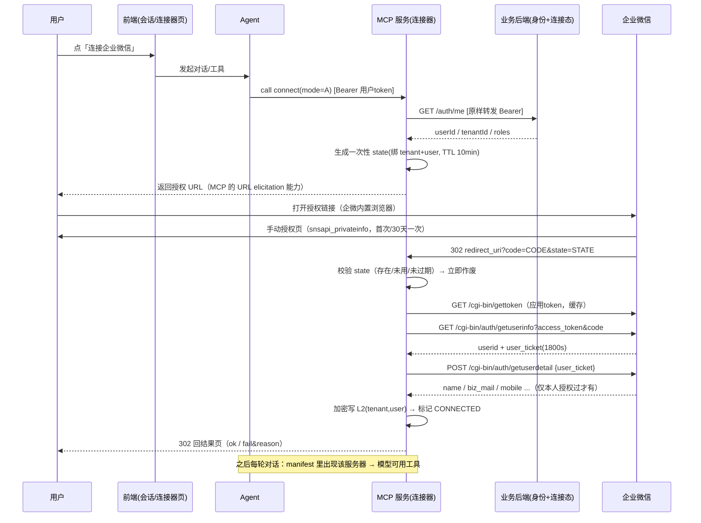

# 63 · 企业微信「按用户跳转授权」接入方案（Agent + MCP）

> ⚠️ **2026-10-30 状态变更**：本文描述的 `wechat_work`（自建应用 + OAuth 网页授权）
> 已下线 **且代码物理删除**（V103 停用 + V104 清工具快照 + 删码，见 `docs/64` §9.7）。
> 其中「按用户授权」的思路被 `wecom_cli`（扫码，每用户独立 CLI 配置目录）延续，
> 但**具体实现完全不同**：没有 corpId/secret、没有 OAuth 回跳、没有 user_ticket。
> 本文保留作设计对照。

> 目标：像 WorkBuddy 那样 —— **每个用户点一下「连接企业微信」，跳转授权一次，之后 Agent 就能以该用户的身份/数据说话**，
> 而不是让每个用户去管理端手填 corpId / secret。
>
> 本文先讲通用设计（可直接照做），再逐条对照**本项目现状**给出「要不要改、改哪、怎么验」。
> 官方依据逐条给了链接；凡属推断的地方都标了「推断」。
>
> 适用范围：企业**自建应用**。第三方服务商应用 / 代开发应用在接口许可与敏感权限上有额外门槛（§8-11），不展开。

---

## 一、先纠一个前提：企微没有「用户级 access_token」

这是本方案最容易被带错的一点，必须放在最前面。

飞书、GitHub、Google 这类平台的 OAuth，会发一个**属于该用户**的 `access_token`，
之后所有调用都拿这枚 token 去代表这个用户。**企业微信不是这个模型。**

企微只有一枚 **应用级（企业级）`access_token`**，由 `corpId + corpSecret` 换得，代表「这个应用」，
不代表任何人。用户授权（OAuth）在你的系统里产生的东西只有两样：

| 拿到的东西 | 内容 | 有效期 | 用途 |
|---|---|---|---|
| `userid` | 该用户在本企业的唯一标识 | 长期（企业内不变） | **之后所有接口的「操作对象」参数** |
| `user_ticket` | 成员票据 | 1800 秒，一次性使用 | 只用于换「敏感字段」（手机/邮箱/企业邮箱等） |

所以「Agent 调该用户自己的企业微信数据」在企微语义下等于：

> 用**应用 token** + **该用户 userid 作为参数**，去调那些接口；
> 其中「敏感字段」之所以能拿到，是因为**该用户本人点过授权**，而不是因为存在一枚用户 token。

由此推出三条硬结论（会影响你的所有设计）：

1. **不能靠 token 天然隔离用户**。隔离必须由你的系统在「谁在调」这一层做（§6），不能指望「拿了他的 token 就只可能读到他的数据」。
2. **`userid` 绝不能由模型作为工具参数传入**。一旦模型能传别人 userid，就等于越权读他人数据（§6-5）。
3. **敏感字段只有「本人授权过」才有**，管理员再怎么配 secret 也拿不到 —— 这恰好也是「必须让用户自己点一下」的官方理由（见 §4 的 2022 改版）。

> 与 WorkBuddy 的差异：WorkBuddy 的企微连接同样只是「拿到 userid + 授权态」，它后续能做的是
> 「代表应用给这个人发消息 / 按人查通讯录」，而不是「拥有这个人账号的全部权限」。别把类比对成飞书。

---

## 二、三层凭据模型

把凭据按「谁的、管什么」分三层，任何按用户授权的连接器都适用：

| 层 | 内容 | 归属 | 谁配置 | 存哪 | 生命周期 |
|---|---|---|---|---|---|
| **L1 应用凭据** | `corpId` / `agentId` / `corpSecret` | 租户 | 管理员配一次 | 服务端保险库（加密） | 长期，轮换时全租户失效 |
| **L2 用户授权** | `userid`、`name`、`biz_mail`、授权时间、连接模式 | 用户 | 用户点「连接」 | 每用户一行（加密） | 用户断开即删；可选 TTL |
| **L3 通道凭据** | MCP 传输层用的「调用者身份」 | 用户 | 登录时已有 | 不落库，随请求头 | 分钟级 |

三条纪律：

- **L1 一对多**：一个租户一份，绝不复制到每个用户；
- **L2 一人一份**：主键必须含 `user_id`，且**只能由本人**读写；
- **L3 不复用 L2**：L3 证明「谁在调我的 MCP」，L2 证明「这人愿意把数据交给平台」。混用会导致「换个 token 就变成别人」。

---

## 三、授权流程设计

### 3.1 时序（以本项目形态为例：Agent → MCP → 回跳）



要点：

- **state 必须一次性 + 与服务端存储绑定**（不是签个时间戳就行）。落库字段：`state / tenant_id / user_id / 目标连接器 / returnPath / created_at / used_at`。
- **回调必须先校验 state 再换取 code**；state 无效应 302 回失败页，**绝不写任何连接**。
- **returnPath 白名单**：只允许同站相对路径（以 `/` 开头、不含 `//`、不含 `\`），并比对 `Origin` 与 `Host` 主机名，
  否则就是开放重定向。
- **code 只能换一次**（官方：code 一次性、5 分钟未使用自动过期）。回调失败不要重试同一个 code，要用户重新授权。

### 3.2 UA 分流：网页授权 vs 扫码

| 入口 | 接口 | scope | 能拿到 | 能否拿敏感字段 |
|---|---|---|---|---|
| 企微/微信客户端内打开（UA 含 `wxwork` / `MicroMessenger`） | `open.weixin.qq.com/connect/oauth2/authorize` | `snsapi_privateinfo` | `userid` + `user_ticket` | ✅ |
| PC 浏览器 | `open.work.weixin.qq.com/wwopen/sso/qrConnect` | — | 仅 `userid` | ❌ |

> 官方明确：**OAuth2 不支持扫码登录**，扫码是另一套 `qrConnect`（path/98151）。
> 所以 PC 端「扫码兜底」只能拿到 `userid`，拿不到企业邮箱；产品上要么接受这个降级，要么引导用户到手机/企微内完成授权。

scope 语义（官方 path/96441 原文）：

- `snsapi_base`：静默授权，只给基础信息（UserId）；
- `snsapi_userinfo`：静默授权，给详细信息但**不含手机、邮箱**；
- `snsapi_privateinfo`：**手动授权**（弹确认页），给详细信息**含手机、邮箱**；
  - 用这个 scope 时 **`agentid` 必填，否则报错**；
  - **成员必须在应用可见范围内**，否则不返回 `user_ticket`（静默降级，见 §8-6）。

### 3.3 失败语义（不要静默）

| 场景 | 期望行为 |
|---|---|
| state 无效/已用/过期 | 302 回 `result=fail&reason=...`，不写连接 |
| `getuserinfo` 拿不到 userid | 回失败页，保留原连接态不变（不要先删再写） |
| 拿到 userid 但无 `user_ticket` | **连接成功但标记降级**：只存 userid，并在状态里写明「敏感字段未授权」。**不能假装拿到了 name/biz_mail** |
| `getuserdetail` 失败 | 同上，不阻断连接（userid 仍有效） |
| L1 未配置 | 直接 400「请管理员先配置应用凭据」，不要跳授权 |

最后两条是「假成功」的高发点：一旦代码把缺失字段写成 `null` 又不告诉调用方，
上层工具（如「我的企业邮箱」）就会返回空值，用户以为「企微里没我的邮箱」。

---

## 四、需要接入的接口与权限范围

> 只列这条链路真正用到的。全部为 HTTPS，`access_token` 为**应用级**。

| # | 接口 | 方法/路径 | 用途 | 关键权限/限制 | 官方 |
|---|---|---|---|---|---|
| 1 | 获取 access_token | `GET /cgi-bin/gettoken?corpid&corpsecret` | 换应用 token | 有效期 7200s；有频率限制（`45009`），必须缓存 | path/91039 |
| 2 | 构造网页授权链接 | `open.weixin.qq.com/connect/oauth2/authorize` | 引导用户授权 | `redirect_uri` 域名须**完全匹配**可信域名 | path/96441 |
| 3 | 获取访问用户身份 | `GET /cgi-bin/auth/getuserinfo?access_token&code` | code → `userid` + `user_ticket` | code 一次性/5min；域名不匹配回 `50001`；`user_ticket` 仅 `snsapi_privateinfo` **且成员在可见范围**时返回，1800s | path/91023 |
| 4 | 获取访问用户敏感信息 | `POST /cgi-bin/auth/getuserdetail` body `{"user_ticket": ...}` | 换 name/mobile/email/**biz_mail**/avatar 等 | **成员必须在应用可见范围内**；`user_ticket` 一次性使用 | path/95833 |
| 5 | 读取成员 | `GET /cgi-bin/user/get?access_token&userid` | 读**指定成员**的详情 | 应用只能读**可见范围内**成员；`60011` = 无权限 | path/96078 |
| 6 | 获取部门成员详情 | `GET /cgi-bin/user/list?access_token&department_id` | 通讯录搜索/列表 | 应用须有该部门查看权限；**2022-06-20 20:00 起不再返回头像/性别/手机/邮箱/企业邮箱/二维码/地址** | path/96260 |
| 7 | 获取成员 ID 列表 | `GET /cgi-bin/user/list_id` | 只取 userid 列表 | 2022-08-15 起「通讯录同步」新增 IP 不能调 `user/list`，应改用本接口 + 部门 ID 列表 | path/96065 |
| 8 | 发送应用消息 | `POST /cgi-bin/message/send` | 给成员发消息 | `touser/toparty/totag` 不能同时为空；`content` ≤ 2048 字节；接口许可不足会出现在 `unlicenseduser`，全部无权限回 `81013` | path/96458 |
| 9 | 扫码登录（可选） | `open.work.weixin.qq.com/wwopen/sso/qrConnect` | PC 兜底登录 | 只给 userid，无敏感字段 | path/98151 |

**权限范围（应用侧要开的东西）**

| 项 | 在哪配 | 不配的后果 |
|---|---|---|
| 应用可见范围 | 应用管理 → 自建应用 → 可见范围 | 不在范围内的人 `user_ticket` 不返回；`getuserdetail` 失败；`user/get` 报 `60011` |
| 可信域名 | 应用 → 网页授权及 JS-SDK → 可信域名 | 授权链接报「redirect_uri 参数错误」；`getuserinfo` 回 `50001` |
| 企业可信 IP | 应用 → 企业可信 IP（**须先有可信域名/接收消息 URL**） | 业务接口全部 `60020` |
| 成员敏感信息授权 | 应用 → 权限 → 成员敏感信息（部分形态需勾选） | `snsapi_privateinfo` 授权后仍拿不到敏感字段 |
| 通讯录权限 | 应用 → 权限 → 通讯录 | 只能读可见范围内；要用「通讯录同步 secret」才能读全公司（**不建议**，见 §8-9） |

**可信域名的三条硬规则**（官方 path/91335 原文）：

1. 必须与访问链接的域名**完全一致**（子域名不算、泛域名不支持）；
2. 链接带端口号时，**端口也要登记**；
3. 与协议头、路径无关（`https://a.com/x`、`http://a.com/y` 都只需登记 `a.com`）。

---

## 五、MCP 服务的连接与鉴权

### 5.1 传输与端点

- transport：`streamable_http`；
- 每个连接器一个端点：`/mcp/<connector_code>`；
- 工具目录由服务端 `list_tools` 下发，agent 侧统一加前缀 `mcp__<code>__<tool>`。

### 5.2 鉴权：**不要把 MCP 服务的 token 当成用户授权**

推荐做法（本项目即如此）：

```
agent ──(Authorization: Bearer <平台用户 accessToken>)──> MCP 服务
                                                        │
                                                        └─原样转发──> 业务后端 GET /auth/me
                                                                      （唯一身份权威）
```

- MCP 服务**不自己验签 JWT**，因为它不该持有平台签名密钥（否则多一个身份权威）；
- 每次工具调用都从**当次请求头**解析身份，进程内只做 60s 的 `token → 身份` 缓存；
- **禁止**把身份缓存到进程级全局变量（多用户并发时会串号，这是最典型的越权事故）。

为什么不用「给 MCP 服务发一个长期 client_secret」：那只能证明「agent 这个进程被允许调 MCP」，
不能证明「当前这轮对话是哪个用户的」，也完全无法支撑 manifest 的按用户裁剪（§5.3）。

### 5.3 按用户裁剪：manifest 是「给不给工具」，gate 是「让不让执行」

两层都要做，缺一不可：

| 层 | 位置 | 判据 | 缺了会怎样 |
|---|---|---|---|
| 发现层 | `GET /api/v1/mcp/manifest` | 该用户 `connection.status == CONNECTED`（租户凭据型则看配置是否就绪） | 模型看不到工具（安全，但功能不可用） |
| 执行层 | MCP `gate` | 按连接模式收窄工具白名单 | 看到工具但执行报错，或**越权执行** |

本项目还多一层「模式闸门」：连接态 `A`（企微 OAuth）/ `B`（邮箱）/ `AB`，
按模式决定哪些工具可用 —— 这样「只连了企微的人」不会看到邮件工具（否则模型会反复调一个必失败的工具）。

### 5.4 工具设计的三条硬规矩

1. **不给模型「指定他人」的能力**：`get_my_profile()` 无参数，`userid` 从服务端连接态取；
2. **写操作要可确认**：发消息这类动作，产物落库（草稿/待发）再由用户点确认，避免模型一次幻觉就发出去；
3. **工具描述要写清「不需要什么参数」**：实测模型会因为「没看到群参数」而反问或乱传参（见 docs/62 §5.7）。

---

## 六、多用户凭证的隔离与管理

### 6.1 存储分层

```sql
-- L1 应用凭据（租户级，一行）
connector_credential(tenant_id, connector_code, field, value_enc)

-- L2 用户授权（每用户一行；主键必须含 user_id）
connector_connection(
  id, tenant_id, user_id, connector_code,
  status,               -- NEED_AUTH / CONNECTED / UNVERIFIED
  account_label,        -- 展示用（建议存 biz_mail 或姓名，别存 userid）
  credential_json_enc,  -- 加密：{userid,name,biz_mail,bound_at}
  connected_at, expires_at, last_error, deleted_at
)
-- 唯一键：(tenant_id, user_id, connector_code)
```

### 6.2 隔离的五个必做项

| # | 要求 | 反例（会出什么事） |
|---|---|---|
| 1 | 查询**永远带 `user_id`**，且 `user_id` 来自鉴权结果，不来自入参 | 用 `userid` 参数查连接 ⇒ 读到别人的邮箱 |
| 2 | 加密存（AES-256-GCM），密钥来自 KMS/env，**不落库** | 明文存库 ⇒ 一次备份泄漏全公司凭据 |
| 3 | 回显只给掩码 + `xxxSet: true` | 直接回明文 ⇒ 管理端截图/日志泄漏 |
| 4 | 断开 = 立即删（或软删并拒绝使用），并失效相关缓存 | 只改状态不删凭据 ⇒ 「已断开」还能被旧 token 调用 |
| 5 | 审计落库：`user_id + tool + args 摘要 + 结果码`，**不记 token/密码** | 不审计 ⇒ 出事无法定位是谁把数据发出去的 |

### 6.3 三个容易忽略的细节

- **access_token 缓存要按租户分桶**，不要全局一份（多租户时会串）；刷新要加锁，
  否则并发刷新撞上 `45009`（官方对 gettoken 有频率限制）。
- **state 与 token 缓存不能只放进程内存**：多副本部署时，用户在 A 实例发起、回调落到 B 实例 ⇒
  state 校验失败。要么粘性路由，要么把 state 放 DB/Redis。
- **软删与唯一键冲突**：`(tenant_id,user_id,code)` 唯一键若不含 `deleted_at`，
  软删行会永久占位，用户第二次连接直接撞唯一键。本项目在 MCP 服务器注册上踩过一模一样的坑。

---

## 七、整体实现步骤（0→6）

| 步 | 做什么 | 完成判据（可验证） |
|---|---|---|
| 0 | 企微侧：建自建应用、配可见范围；**有域名**则配可信域名 → 再加可信 IP | `gettoken` 成功 **且** `user/get` 返回 0（**不能只验 gettoken**，它不校验 IP） |
| 1 | L1 落库：管理端填 corpId/agentId/secret，加密存 | 回查保险库 `configured=true`；回显无明文 |
| 2 | L2 表 + 加密 + 唯一键 | 同一用户重复连接是 update 不是报错 |
| 3 | 授权发起：state 一次性 + returnPath 白名单 + Origin 校验 | 伪造 state 被拒且**不写连接**；`returnPath=//evil.com` 被 400 |
| 4 | 回调：code→userid→user_ticket→getuserdetail→落库 | 真机：`credential` 里 `name`/`biz_mail` **非空** |
| 5 | MCP 侧：`/mcp/<code>` + `connect/status/disconnect` + 业务工具 + gate | `list_tools` 的 `required` 与契约逐字一致；未连接时执行被拒且文案可读 |
| 6 | manifest 闸门 + agent 注入 | 连上后 **新开一轮对话**模型手里出现 `mcp__<code>__*`（不是重启才出现） |

验收一定要有**两套**：mock（跑逻辑与边界）+ 真机（跑凭据与权限）。只跑 mock 会在真机上翻车 ——
本方案 §9 的第 1 项就是这么被藏住的。

---

## 八、关键注意事项（按踩坑概率排序）

1. **`gettoken` 不校验可信 IP**。拿得到 token 只证明 secret 对；IP 校验在业务接口。验「配好了没」必须再打一个业务接口。
2. **「配置可信 IP」有前置**：必须先有可信域名或接收消息服务器 URL，二者都要**备案域名**。
   没有备案域名 ⇒ 自建应用的业务接口整体走不通，不是「只差加白」。同一出口 IP 的对照实验见 docs/62 §5.7。
3. **可信域名完全匹配**，含端口；不支持泛域名；**不能填 IP**。回调 URL 写 IP 一定失败。
4. **`snsapi_privateinfo` 必填 `agentid`**，漏了直接报错；`#wechat_redirect` 也不能丢。
5. **`code` 一次性 + 5 分钟过期**；`user_ticket` 1800 秒且**只能用一次**。不要缓存 user_ticket 复用。
6. **成员不在应用可见范围 ⇒ `user_ticket` 不返回**（不报错！）。这是最阴的静默降级：
   代码若不检查「有没有 ticket」，会得到「连接成功但没名字没邮箱」。
7. **2022-06-20 20:00 起，`user/list` 等通讯录接口不再返回手机/邮箱/企业邮箱**。
   敏感字段只能走「本人 OAuth + `getuserdetail`」。这就是「必须让用户点一下」的官方理由，别试图用管理员 secret 绕过。
8. **敏感信息授权有 30 天记忆**：首次手动授权后 30 天内不再弹窗。用户改授权要去
   企微里「应用详情 → 个人敏感信息授权管理」自己改，你的系统无法代改 —— UI 上要给出这句引导。
9. **不要用「通讯录同步 secret」图省事**：它权限过大（可读全公司），一旦泄漏影响面是全企业；
   且 2022-08-15 起新增 IP 已不能调 `user/list`。
10. **上下游/企业互联不支持 `user_ticket`**（官方明确）。这类场景只能拿 userid。
11. **接口许可**：`message/send` 对「有可见范围但无接口许可」的成员会返回在 `unlicenseduser`；
    全部接收人无权限时整体失败（`81013`）。生产要处理这个分支，不能当成功。
12. **接口许可/敏感权限变更后要重新 `gettoken`**：旧 token 保留旧权限。
13. **别把 token 打进日志**：HTTP 客户端（httpx/requests）会在 INFO 级别打印**完整 URL**，
    而企微把 `access_token` 放在 query 里 —— 必须做脱敏（本项目在 `group.py` 装了过滤器，仍建议全局统一）。
14. **`userid` 不是敏感信息，但组合起来是**：`userid + 手机号 + 邮箱` 就是一份员工档案。存哪、谁能读要按敏感数据对待。

---

## 九、本项目现状：架构不用重做，但有 5 处要动

先说结论：**「按用户跳转授权」的骨架已经在了**，不需要重新设计。

已具备（有代码可指）：

| 能力 | 位置 |
|---|---|
| 一次性 state（10min TTL、消费即作废） | `WeComOAuthService.start/callback`、hub `store.issue_state/consume_state` |
| code → userid → user_ticket → getuserdetail | `WeComOAuthService.callback`、hub `server.complete_oauth` |
| 每用户一行连接态 + 加密凭据 | MySQL `connector_connection`、hub `wecom_connection` |
| 按用户裁剪 manifest | `McpRegistryService.usableForAgent`（含 API_KEY 型分支） |
| 模式闸门（A/B/AB） | `wecom/gate.py` |
| MCP 鉴权＝透传 Bearer 回打 `/auth/me` | `wecom/identity.py` |
| UA 分流（网页授权 / 扫码兜底） | 两侧都有 |

下面是需要动的，按「必修 → 建议 → 外部前置」排序。

### 9.1 【必修】hub 的 `exchange_code` 与官方不一致，真机会静默丢 `user_ticket`

- 现状：`mcp-hub/mcp_hub/wecom/wecom_api.py:177-183` 调 **`/cgi-bin/user/getuserinfo`**，并读字段 **`ticket`**；
- 官方：`GET /cgi-bin/auth/getuserinfo`，返回字段为 **`user_ticket`**（path/91023）；
- 后果：真机上 `user_ticket` 取不到 ⇒ `complete_oauth` 跳过 `getuserdetail` ⇒
  `a_credential` 只有 `userid`，`name`/`biz_mail` 为 `null`，且**不报错**；
- 为什么一直没发现：mock 的 `exchange_code` 直接返回 `user_ticket`（`wecom_api.py:91`），
  绕过了真实分支的字段名问题 —— 20 项双模式哨兵全绿也测不出来；
- 修法：路径改 `auth/getuserinfo`、字段读 `user_ticket`（保留对 `ticket` 的兼容读取）；
- 判据：真机授权一次后，`a_credential.name` 与 `biz_mail` 非空（`GET /api/v1/connectors/wechat_work/credentials` 或查库）。
- 附带：`complete_oauth` 在「没有 user_ticket」时应**明确标记降级**（§3.3 最后一行），
  而不是静默成功。

### 9.2 【必修】用户连接态有两个源，且 manifest 闸门读的不是执行侧那个

- Java `connector_connection`：`WeComOAuthService.callback` 写；**manifest 闸门读它**（`connectionService.statusOf`）。
- hub `wecom_connection`：`server.complete_oauth` 写；**工具执行读它**（`gate.py` + 执行器 payload）。
- 两边**没有任何回写**（hub 只回打 `/auth/me` 取身份）。
- 后果：用户通过 Agent 里的 `connect` 工具（hub 路径）授权成功 ⇒ Java 表仍是 `NEED_AUTH` ⇒
  下一轮 `manifest` 判未连接 ⇒ **工具从模型手里消失**。反向（走 Java 回调）则 hub 侧无凭据 ⇒ 执行报「凭据缺失」。
- 修法（二选一，推荐 A）：
  - **A. 单一真相源**：hub 授权成功后回调 Java 的 `POST /api/v1/connectors/{code}/connection`（内部令牌 + 服务鉴权）落 Java 表；
    Java 侧只当缓存展示。或者干脆让 hub 的 `wecom_connection` 退役，执行侧改读 Java（需内网接口）。
  - **B. 双写 + 对账**：两条路径都写两处，并加一个日对账哨兵。
- 判据：`connect` 成功后立即 `GET /api/v1/mcp/manifest`，**必须含 `wechat_work`**；断开后必须不含。
  这条现在没有任何哨兵覆盖，建议补进 `_verify_wecom_dual_mode_p0.py`。

#### 9.2.1 已按 A 方案实施（2026-10-30）

落地链路（一条也不能少）：

```
hub wecom/server.complete_oauth / _tool_disconnect
   → wecom/sync.py（HS256 服务令牌，svc=hub）
   → POST /internal/v1/connectors/{code}/connection[/disconnect]
   → ConnectorConnectionService.upsertConnectedByUser / disconnectByUser
   → connector_connection（唯一真相源）
   → /api/v1/mcp/manifest 闸门 + /api/v1/connectors 目录，两处同读一张表
```

实施中踩到的四个点，都是「看起来只是接线、实际会出错」的地方：

1. **服务间令牌要放开 `svc=hub`**：`ServiceTokenProvider.ALLOWED_SVC` 原本只有 `agent`/`server`，
   `/internal/**` 走 `ServiceTokenFilter`，不加 `hub` 就是一路 401。
2. **`updateById(null)` 清不掉列**：MyBatis-Plus 默认 `NOT_NULL` 策略下，传 null 的字段**不进 UPDATE**。
   断开时清 `credential_json` / `last_error` 必须用 `LambdaUpdateWrapper.set(...)` 显式写列。
3. **`synced` 必须是三态，不能压成 bool**：`True`=已同步 / `False`=真失败 / `None`=**按设计跳过**
   （mock 身份不是数据库主键、或本进程没配服务令牌）。压成 bool 的后果很隐蔽——dev 默认
   `WECOM_MOCK=1`，每次授权都算出 `wecom=partial&reason=state-unsynced`，把正常跳过当成故障报给用户，
   真正的失败反而被噪声淹没（本次 `_verify_wecom_dual_mode_p0` S4b 因此假失败过一次）。
4. **目录里的连接态只信库**：`ConnectorCatalogService.list()` 原先把 `configReady` 当门，
   未就绪就把 status 强降级成 `NEED_AUTH`。这条会造出「manifest 已放行、界面却显示未连接」的自相矛盾
   （S5 通过而 S4 失败）。应用配置就绪度是**另一根轴**，由 `configReady` + `configHint` 表达，
   前端本来就按 `configReady` 先分支（`user-client/_oa_app.js` 的 `connStatusChip`/`connCardHtml`）。

顺带补上的两个缺口：`ConnectorItem` 增加了 `configHint`（前端早就在读 `c.configHint`，
但后端从没返回过，只能落到写死的兜底文案）；`_verify_connector_state_sync.py` 7 项哨兵
（S1/S2 验令牌闸门、S3 写入、S4 目录第二源、S5/S6 manifest 双向、S7 同步客户端打桩验路径与布尔转小写）。

> 运维提醒：hub 进程必须拿到 `AIOS_SERVICE_JWT_SECRET`（与 Java `aios.service-jwt.secret` 逐字一致）。
> 没拿到时**不报错**，只是每次授权都 `state-unsynced`。用 `start-all.sh` 启动即自带该变量；
> 用临时脚本单独重启 hub 时最容易漏。

### 9.3 【建议·安全】`send_text_message` 允许模型指定任意收件人

- 原状：`_exec_send_text` 要求 `touser` 非空，由模型填（`wecom/server.py`）。
- 问题：这是「应用视角」而不是「用户视角」—— 用户 A 的会话里，模型可以给同企业任何人发消息，
  用户会以为「只动我的账号」。在「按用户授权」的语义下这是越权。
- **已修（2026-10-30）**：`touser` 改为可选，语义翻转成「**留空 = 发给当前授权用户本人**」；
  传了别人的 userid 而没带 `confirmed=true` ⇒ 直接拒绝（错误文案要求先问用户）；
  `confirmed=true` 才放行，并落 `logger.warning` 留痕；返回体带 `toSelf` 便于模型自检。
  工具描述首句就写明这条（描述决定模型调不调、怎么调）。
- 判据（`_verify_wecom_dual_mode_p0`）：S7 指定本人可发；S7b 不传 `touser` 发本人且 `toSelf=true`；
  S7c 未确认发他人被拒；S7d 确认后放行且 `toSelf=false`。

> 为什么不用白名单：没有可靠数据源能界定「这个人能不能发给那个人」，硬编一份只会变成假安全。
> 「显式确认」把判断权交回用户，且可审计。

### 9.4 【建议·语义】`contact_search` 读的是全员可见范围，且 `bizMail` 恒为空

- 原状：`wecom_api.search_contact` 调 `user/list?department_id=1&fetch_child=1`（应用 token 读可见范围全员），
  并把 `biz_mail` 映射进结果。
- 两个问题：
  1. 这不是「该用户自己的数据」，而是「应用能看到的通讯录」——与「按用户授权」的叙事不一致；
  2. 官方 2022-06-20 后 `user/list` **不再返回 `biz_mail`**，该字段真机恒为 `null`（mock 里有值，又是 mock 掩盖）。
- **已修（2026-10-30）**：
  - `search_contact` 两个后端（实装 + mock）都不再映射 `biz_mail`，只返回 `userid/name/position/department`；
    mock 同步去掉该字段 —— 不同口径的 mock 等于第二层掩盖。
  - `_exec_contact_search` 给每行补 `isSelf`；**只有本人那一行**才从 `a_credential` 补 `bizMail`，
    并在返回体加 `scope` 说明「这是应用可见范围，不是我的联系人」。
  - 「读我自己的详情」不新增工具，直接增强已有 `get_my_profile`：凭据字段 + `user/get` 的
    姓名/职务/部门/状态（取不到时降级标注 `memberUnavailable`，不让查资料变硬失败）。
  - 判据：S8b —— 他人行无 `bizMail` 且 `isSelf=false`；本人行 `isSelf=true` 且邮箱来自授权。

#### 9.4.1 实施时发现的第二个参数源（会静默错调）

企微工具的参数有两处事实源：`wecom/catalog.py` 的 `input_schema.required`（决定**模型看到什么**）
与 `wecom/server.py::_PARAMS`（决定**真正校验什么**，`default=None` 即必填）。
本轮只改了前者，结果描述说「touser 可省略」、真调用却被 pydantic 判缺参（S7b/S7d 因此挂了）。
现已加 `_assert_params_in_sync()` 在 `build_server()` 里做启动自检：两边 `required` 不一致就**拒绝启动**，
不再靠人记得同时改两处。

### 9.5 【外部前置】A 模式真机的唯一硬阻塞：备案域名

- 企微要求：可信域名 → 才能配可信 IP；可信域名必须**备案**且主体与企微企业主体一致/关联。
- 没有备案域名时：
  - 网页授权（`snsapi_privateinfo`）不可用 ⇒ 拿不到 `user_ticket` ⇒ 拿不到姓名/企业邮箱；
  - 业务接口（`message/send`、`user/get`）也不可用（`60020`）；
  - 可用的只有：**群机器人**（docs/62 §5.7，不要求 IP/域名/认证）与**邮箱模式 B**（IMAP/SMTP）。
- 这一条代码解决不了，只能：① 备案域名 + 固定公网 IPv4；② 换服务商代发；③ 接受降级（群消息 + 邮箱）。

### 9.6 一张表总结

| # | 事项 | 性质 | 不改的后果 | 状态 |
|---|---|---|---|---|
| 1 | `exchange_code` 路径/字段对齐官方 | 代码 bug | 真机 A 模式无姓名/企业邮箱，且不报错 | **已修** `ee9ad02` |
| 2 | 连接态双源收敛（或闸门改读 hub） | 架构缺陷 | 连上了但工具消失 / 工具在但执行报缺凭据 | **已修** `ee9ad02` |
| 3 | `send_text_message` 收件人收窄 | 越权风险 | 可被用来给任意同事发消息 | **已修**（留空=本人 + `confirmed` 闸门） |
| 4 | `contact_search` 语义 + `bizMail` 来源 | 语义/正确性 | 返回空邮箱，用户以为没配 | **已修**（`isSelf` + 邮箱只取授权） |
| 5 | 备案域名 + 固定 IP | 外部前置 | 自建应用整条路不可用 | 阻碍项（代码解决不了） |

> 若只想「让 Agent 能替用户办事」而不追求「读该用户的敏感档案」，**P0-2 也可以先绕**：
> 把 A 模式暂时下线，只保留群机器人（发群消息）+ 邮箱模式 B（收发本人邮件），
> 这两条都不依赖域名，能立刻给用户看到价值；等域名下来再开 A 模式。

---

## 十、与 WorkBuddy 的类比：哪些能照搬，哪些不能

| 维度 | 能否照搬 | 说明 |
|---|---|---|
| 「连接器中心」UI + 跳转授权 | ✅ | 通用模式：卡片 + 状态 + 连接/断开 |
| 每用户凭证隔离（一人一行、加密、掩码） | ✅ | 与平台无关 |
| MCP 作为工具通道 + 透传 Bearer | ✅ | 与平台无关 |
| 「一次授权后 Agent 拥有该用户全部数据」 | ❌ | 企微**没有用户级 token**，能力上限由应用可见范围 + 接口许可决定 |
| 「用用户 token 直连被调 API」 | ❌ | 企微所有业务调用都用应用 token；用户身份只体现为参数 |
| 「静默授权即可拿邮箱」 | ❌ | 必须 `snsapi_privateinfo` 手动授权；且 30 天内不重复弹 |

---

## 附：官方文档索引

| 主题 | 链接 |
|---|---|
| 构造网页授权链接（自建应用） | https://developer.work.weixin.qq.com/document/path/96441 |
| 获取访问用户身份（`auth/getuserinfo`） | https://developer.work.weixin.qq.com/document/path/91023 |
| 获取访问用户敏感信息（`auth/getuserdetail`） | https://developer.work.weixin.qq.com/document/path/95833 |
| 获取部门成员详情（`user/list`，敏感字段变更说明） | https://developer.work.weixin.qq.com/document/path/96260 |
| 发送应用消息（`message/send`） | https://developer.work.weixin.qq.com/document/path/96458 |
| 扫码登录（`qrConnect`） | https://developer.work.weixin.qq.com/document/path/98151 |
| 可信域名规则与 OAuth2 须知 | https://developer.work.weixin.qq.com/document/path/91335 |
